<p align="center">
  <a href="https://corrooli.github.io/THEODOR/">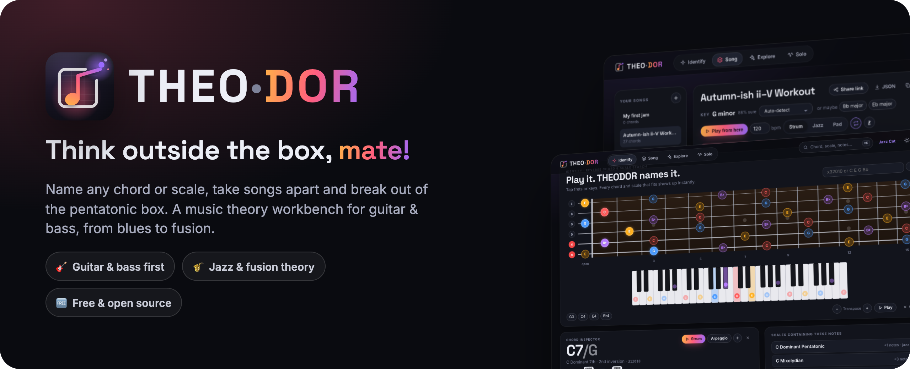</a>
</p>

<p align="center">
  <a href="https://corrooli.github.io/THEODOR/">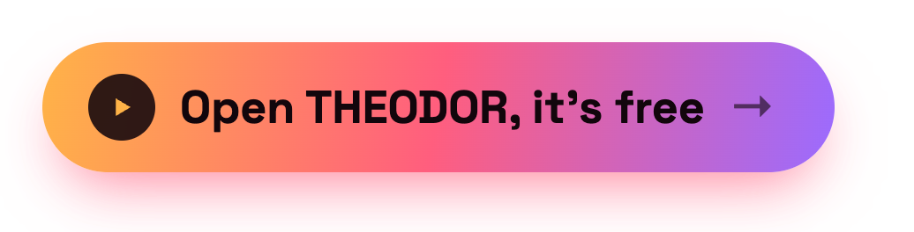</a>
</p>

<p align="center">
  <a href="https://github.com/corrooli/THEODOR/actions/workflows/ci.yml"></a>
  
  
  
</p>

<p align="center"><b>THEO</b>ry + <b>DOR</b>ian. A music theory workbench for guitarists, bassists and bands.<br>
Name what you hear, take songs apart, and break out of pentatonic monotony.</p>

---

## 🎸 What you can do

| | |
|---|---|
| 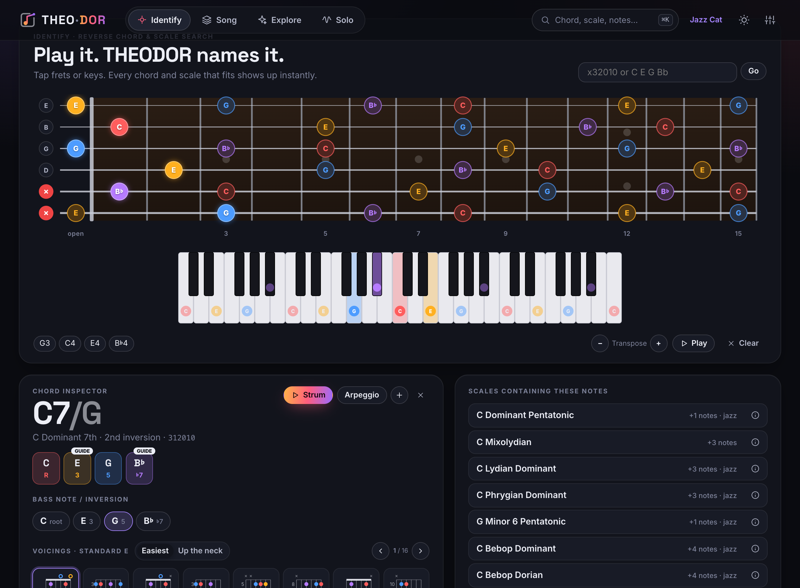 | ### 🎯 Identify<br>Tap the fretboard or piano, type a tab (`x32010`) or notes (`C E G Bb`), play your **MIDI keyboard** or use your computer keyboard. You get the chord name, other ways to name it, and **every scale** those notes fit in.<br><br>Open the **chord inspector** to change the bass note (inversions), step through playable voicings and **transpose** by a semitone. |
| ### 🧱 Song<br>Build songs out of sections. THEODOR **finds the key**, writes the **Roman numerals**, colours each chord by its job (home, away, tension) and explains in plain English **why it works**: secondary dominants, tritone subs, borrowed chords…<br><br>Tap any chord for **reharm ideas** you can **hear before you use them**. | 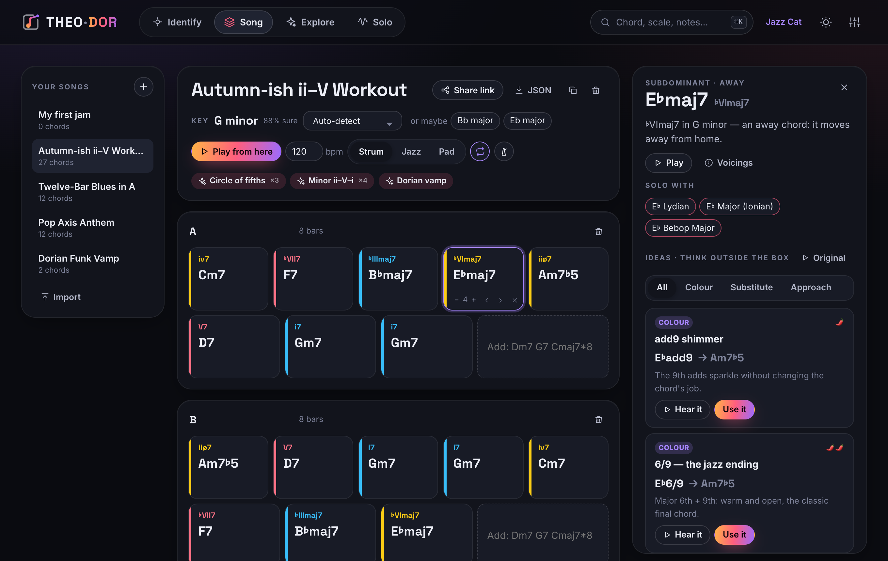 |
| 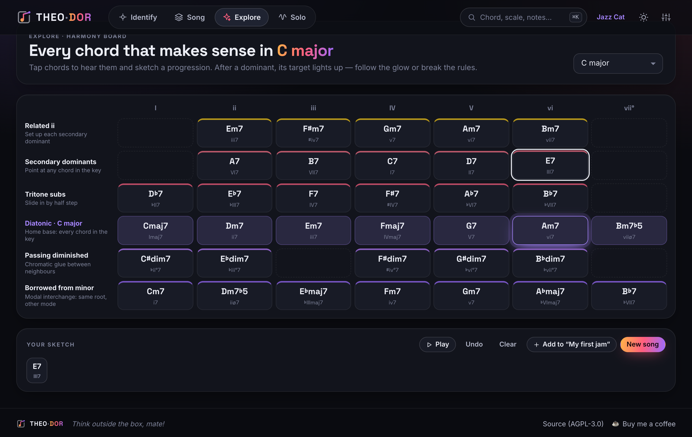 | ### ✨ Explore<br>A **harmony board** for any key: diatonic chords, secondary dominants, related iis, tritone subs, passing diminished chords, borrowed chords and fusion colours, all in one grid. After a dominant, the chord it resolves to **lights up**. Sketch a progression, then send it to a song. |
| ### 〰️ Solo<br>Loop the song and see **what to play over each chord** on the neck. Chord tones and guide tones are highlighted, and you can lock it to one position.<br><br>Press ▶ on any scale to **hear it over the chord**, or turn on the **demo solo line**. *Break the box* gives every chord its own colour. | 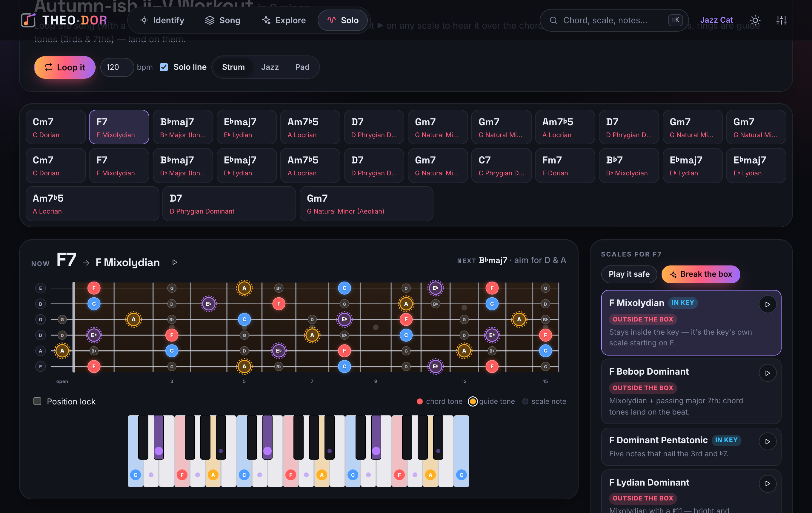 |

<p align="center">
  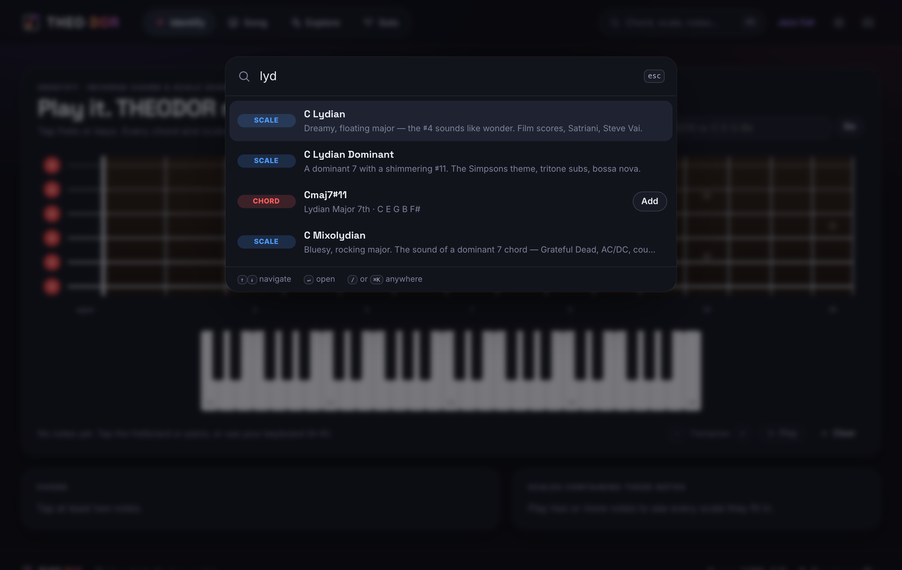
  &nbsp;
  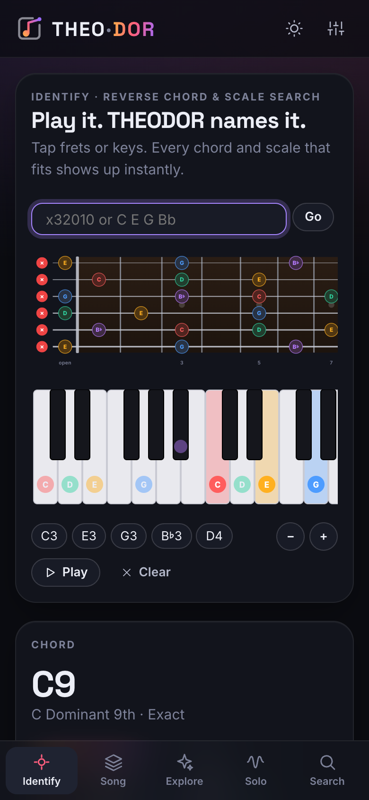
</p>
<p align="center"><sub><b>⌘K</b> or <b>/</b> anywhere: one box for forward <i>and</i> reverse chord &amp; scale search. And it all works on your phone too.</sub></p>

## 🔁 How it fits together

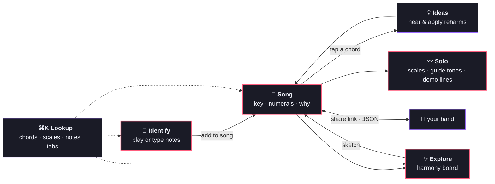

## 🎚️ Pick your depth

The same app works for a beginner and for a jazz nerd. Depth decides which scales, chords and ideas THEODOR suggests. You can always look up anything.

```mermaid
flowchart LR
    subgraph L1["⚖️ Blues Lawyer"]
      direction TB
      a1["Major / minor / pentatonic / blues"]
      a2["Secondary dominants, borrowed chords"]
      a3["Plain-English explanations"]
    end
    subgraph L2["🐈‍⬛ Jazz Cat"]
      direction TB
      b1["Modes & 7th-chord harmony"]
      b2["ii–V–I, tritone subs, related iis"]
      b3["Extensions, bebop scales"]
    end
    subgraph L3["🧙 Fusion Wizard"]
      direction TB
      c1["Melodic & harmonic minor modes"]
      c2["Altered, diminished, whole-tone"]
      c3["Modal colours, outside sounds"]
    end
    L1 ==> L2 ==> L3
    style L1 fill:#2a1f14,stroke:#ffb347,color:#eceef6
    style L2 fill:#2a1420,stroke:#ff5e7e,color:#eceef6
    style L3 fill:#1d1630,stroke:#9b6bff,color:#eceef6
```

## 📦 What's inside

<table>
<tr>
<td align="center"><h3>59</h3>chord types<br><sub>triads → 13♯11</sub></td>
<td align="center"><h3>47</h3>scales &amp; modes<br><sub>with plain-English vibes</sub></td>
<td align="center"><h3>20+</h3>named progressions<br><sub>ii–V–I, Axis, Andalusian…</sub></td>
<td align="center"><h3>27</h3>tunings<br><sub>drop, open, 7-string, bass 4/5/6</sub></td>
<td align="center"><h3>0</h3>accounts<br><sub>everything stays in your browser</sub></td>
</tr>
</table>

- **Guitar & bass first.** Real fret spacing, left-handed mode and a voicing finder that checks fingers, barres and string skips. Piano too.
- **Voicing-aware sound.** Strum, jazz comping or pads, with a bass line and a click. Hear every idea in context before you commit to it.
- **Share with your band.** The whole song is packed into the link (`#/song?s=1.…`). JSON export and import also work. Links are versioned and old ones will keep working.
- **Private by design.** No backend, no tracking. Install it to your home screen like an app.

## 🛠️ Development

```bash
npm install
npm run dev        # http://localhost:5173/THEODOR/
npm test           # unit tests: theory engine, song format, lick generator
npm run check      # svelte-check / TypeScript
npm run test:e2e   # Playwright, desktop + phone (CHROMIUM_PATH=… to use a local Chromium)
npm run build      # static site in dist/
```

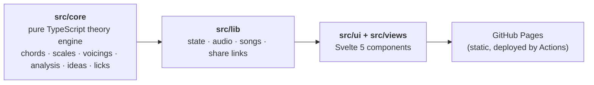

Stack: **Svelte 5 + TypeScript + Vite**. The theory engine in `src/core/` has no dependencies and is fully unit-tested. Every push to `main` is checked, tested in a real browser and deployed to GitHub Pages.

## ⚖️ License

The code is licensed under the [GNU AGPL-3.0](LICENSE). You may use, study, change and share it. If you run a modified version as a public service, you must publish your source code too.

**Trademark note:** the name **THEODOR** and the THEO·DOR logo are *not* licensed under the AGPL. Forks are welcome, but please give yours its own name and logo.

<p align="center">
  <br>
  <a href="https://corrooli.github.io/THEODOR/">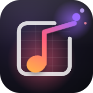</a><br>
  <b>Think outside the box, mate!</b><br>
  <sub>If THEODOR helps your band, <a href="https://ko-fi.com/olivercorrodi">buy me a coffee ☕</a></sub>
</p>
